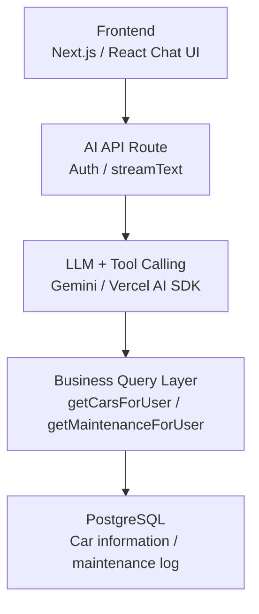

# Car Doctor

## Features

- Manage cars
- Manage maintenance history
- maintenance notification
- Chat with LLM
- AI Tool calling

## Tech stacks

- Next.js 16 + React 19 + Tailwind CSS 4 + Shadcn + Vercel AI elements
- PostgreSQL(Supabase) + Drizzle
- Supabase Auth
- Vercel AI SDK 7 + Gemini-3.5-flash-lite

## Engineering

- husky + lint-staged + gitleaks

## Architecture

## Web URL

<https://car-dr-nextjs.vercel.app/>
